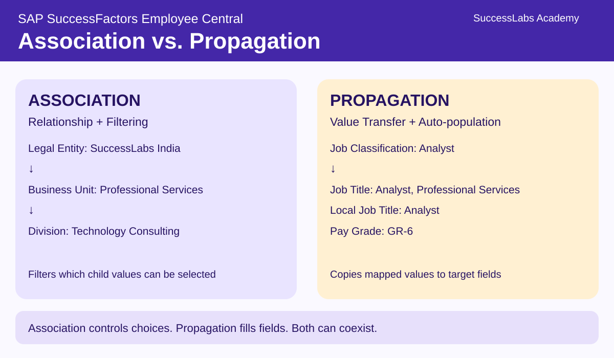

# SAP SuccessFactors EC — Association vs. Propagation

**SuccessLabs Academy | Foundation → Essentials**

## Comparison

| Dimension | Association | Propagation |
|---|---|---|
| Meaning | Defines relationships between Foundation Objects or MDF objects | Transfers mapped source values to target fields |
| Main purpose | Control which related values can be selected | Automatically populate target fields |
| Key question | Which values are available? | Which values should be copied? |
| Example | Business Unit → Division | Job Classification → Job Title |
| User experience | Child dropdown is filtered by parent | Related fields are auto-filled |
| Configuration | Object Definitions and association settings | HRIS propagation configuration or business rules |
| Data copying | No inherent copying | Yes, when configured |
| Dependency | Does not require propagation | Does not necessarily require association |

## Example 1: Association

Select Legal Entity **SuccessLabs India**, then Business Unit **Professional Services**. The Division dropdown may show only associated divisions such as **Technology Consulting**. The relationship restricts choices; it does not copy values.

## Example 2: Propagation

Select Job Classification **Analyst, Professional Services (SVC-ALYST)**. If configured, this may populate:

| Target | Illustrative value |
|---|---|
| Job Title | Analyst, Professional Services |
| Local Job Title | Analyst, Professional Services |
| Pay Grade | Salary Grade 6 (GR-6) |
| Standard Weekly Hours | 40, if mapped or derived |

## How to verify in SAP EC

1. Inspect the relevant Foundation Object / MDF association configuration in **Configure Object Definitions** or the applicable legacy configuration.
2. Inspect **Admin Center → Manage Business Configuration → jobInfo**.
3. Review propagation mapping and relevant onChange / onInit business rules.
4. Change Business Unit to test dropdown filtering.
5. Change Job Classification to test automatic population.
6. Record the mechanism verified in configuration.

**Caution:** Automatic population does not by itself prove native propagation; business rules can produce similar behavior. These values are illustrative, not universal defaults.

## Learner experiment

**Scenario A:** Legal Entity selection filters Business Units. Identify the association.

**Scenario B:** Job Classification selection fills Pay Grade. Determine whether it is propagation or rule-based derivation by checking configuration.

**Takeaway:** Association = Relationship + Filtering. Propagation = Value Transfer + Automatic Population.

*SuccessLabs Academy — Architecting Experiences for a Better World.*
